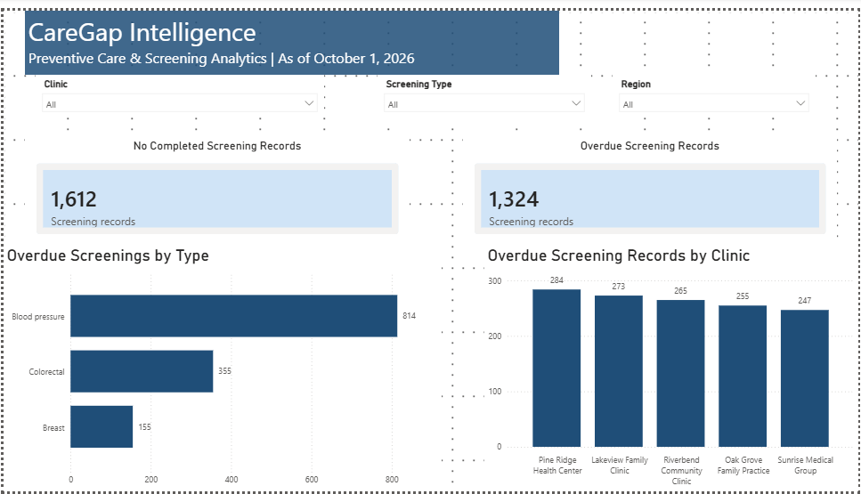
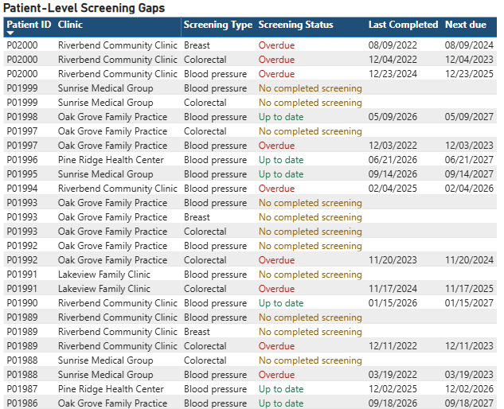
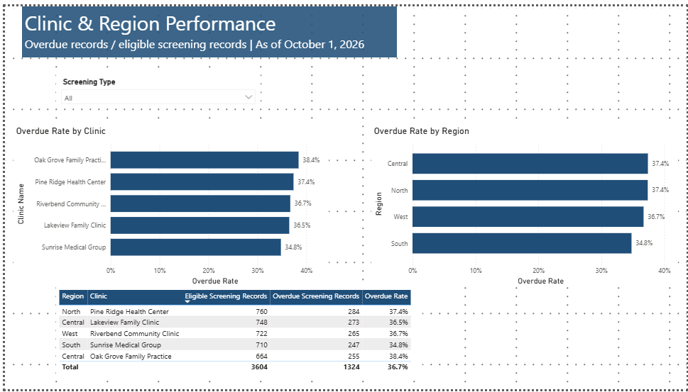

# CareGap Intelligence

Preventive screening gap analysis using Snowflake, SQL and Power BI.

## Project purpose

Identify eligible screening records that are overdue or have no completed screening recorded, and explore differences across screening types, clinics, and regions.

This portfolio project uses synthetic data. The analysis date is October 1, 2026.

## Tools and data

- Snowflake SQL: eligibility logic, screening status classification, and summary tables
- Power BI: interactive dashboards, DAX measures, and patient-level reporting
- Source datasets: patients, clinics, encounters, screenings, and screening rules

## Screening rules

The following simplified rules were used for this training project. They are not clinical recommendations.

| Screening | Eligibility | Screening interval |
|---|---|---|
| Blood pressure | Ages 18–120 | 12 months |
| Breast | Female patients, ages 40–74 | 24 months |
| Colorectal | Ages 45–75 | 12 months |

## Status definitions

- **Overdue:** A completed screening is recorded, but the next due date is before the analysis date.
- **Up to date:** The next due date is on or after the analysis date.
- **No completed screening:** No completed screening with a valid date was found for that patient and screening type.

No completed screening recorded does not necessarily mean a patient was never screened.

Each analysis record represents one patient and one screening type. One patient can therefore appear in multiple records.

## Overall results

| Metric | Result |
|---|---:|
| Unique eligible patients | 1,992 |
| Eligible screening records | 3,604 |
| Overdue screening records | 1,324 |
| No completed screening records | 1,612 |
| Up-to-date screening records | 668 |
| Overdue rate | 36.7% |

Overdue rate = overdue screening records / eligible screening records.

Combined rates are calculated from the underlying counts rather than averaging clinic percentages.

## Key findings

1. **Open gaps affect 81.5% of eligible screening records.**
   There are 2,936 records classified as overdue or no completed screening recorded.

2. **Blood pressure has the largest overdue workload.**
   It accounts for 814 overdue records, followed by colorectal with 355 and breast with 155.

3. **Counts and rates highlight different priorities.**
   Pine Ridge has the highest overdue count at 284. Oak Grove has the highest overall overdue rate at 38.4%.

These findings can help prioritize record review and outreach planning within the synthetic scenario.

## Power BI report

### Page 1: CareGap Intelligence
Overview of screening gaps, with clinic, screening type, and region filters.

### Page 2: Patient-Level Gaps
Patient–screening records with readable status labels, dates, conditional formatting, and filters synced from page 1.

### Page 3: Clinic & Region Performance
Overdue rates by clinic and region, supported by eligible and overdue record counts and a screening type filter.

## Validation

Selected dashboard results were checked against the SQL analysis, including:

- Overall eligible and overdue record totals
- Breast screening totals and overdue rate
- Combined clinic and screening type filters
- Region filtering and chart interactions
- Synced filters on the patient-level page

## Limitations

- The data is synthetic and does not represent actual patients or clinic performance.
- Screening rules are simplified project assumptions.
- Missing screening documentation may reflect incomplete records.
- Overall clinic rates combine different screening types and eligible populations. Use the screening type filter for more focused comparisons.
- The report is a snapshot as of October 1, 2026.
- ## Dashboard screenshots

### Overview

### Patient-Level Gaps

### Clinic & Region Performance

